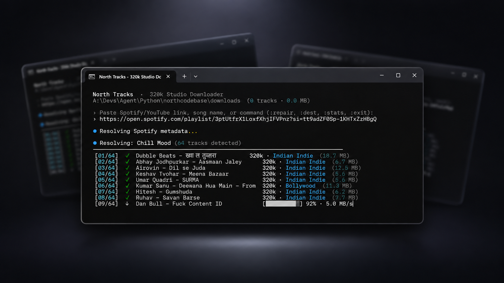

# NISHANT KUMAR MISHRA

`Open-Source Developer · Desktop & CLI Systems · India`

  <a href="https://nishantkumrmishra.github.io/nishantkumrmishra/"><b>Click to open the website →</b></a>

---

### About Me

I'm Nishant, a self-taught developer focused on building fast, reliable, and minimal desktop and command-line tools. I enjoy exploring audio engines, streaming protocols, and clean terminal interfaces.

- **Desktop & CLI Architecture:** Focused on lightweight binaries, single-screen terminal dashboards, and local file organization.
- **Audio & Media Pipelines:** Stream decryption, metadata tagging, and multi-tier artwork verification.
- **Developer Experience:** 1-click installers, standalone executables, and zero-configuration setups.

---

### Featured Project: North Tracks

  

#### [North Tracks — 320k Studio Downloader & Library Engine](https://github.com/nishantkumrmishra/north-tracks)

North Tracks is a minimal command-line music downloader and library organizer. It allows you to paste Spotify playlists, YouTube links, or song titles, and downloads authentic 320kbps audio with official HD artwork, automatically organizing every track into genre folders.

**Key Architecture & What Was Built:**
* **Clean Single-Screen Terminal UI:** Built a flicker-free dashboard that clears terminal clutter on launch, maintains in-place stream progress updates, and provides simple shortcut navigation (`Ctrl+C` to exit, `:stats`, `:repair`, `:dest`).
* **320kbps Studio Stream Decryption:** Extracts studio-grade unthrottled AAC-LC audio directly from Akamai CDN nodes using DES-ECB stream decryption and bitrate rewriting.
* **Dual Artwork Verification Pipeline:** Verifies official album art using Apple iTunes HD (600×600 / 1000×1000) with automatic fallback to JioSaavn's 500×500 CDN repository.
* **Intelligent Library Routing:** Categorizes songs into dedicated genre folders (`Indian Indie/`, `Bollywood/`, `Punjabi/`, `Pop/`, `Rock/`, `Hip-Hop/`) based on artist fingerprinting and language heuristics rather than flat playlist dumps.
* **Fuzzy Duplicate Detection:** Fingerprints library files before requesting streams to skip already-downloaded tracks and film remasters automatically.
* **Standalone Windows Executable:** Bundled into a portable 17MB executable (`NorthTracks.exe`) with a custom application icon that runs on any PC with zero Python or dependencies required.
* **Published on PyPI:** Globally installable via `pip install northtracks` across Windows, macOS, and Linux.

---

### Technologies & Stack

  
  
  
  
  
  
  
  
  
  

---

### Engineering Principles

1. **Build first, learn continuously:** Practical insights come from shipping real code and testing architectures hands-on.
2. **Keep software simple and maintainable:** Avoid unnecessary complexity; prioritize readable, predictable software.
3. **Prefer modular and extensible design:** Decouple core engine logic, formatters, and network handlers into isolated modules.
4. **Clean user interfaces:** Minimize visual noise, eliminate terminal jitter, and keep navigation intuitive.
5. **Share useful work:** Provide standalone builds, clean documentation, and public packages for the open-source community.

---

### [Visit the Live Portfolio Website](https://nishantkumrmishra.github.io/nishantkumrmishra/)

*Learning, building, experimenting, and improving.*

